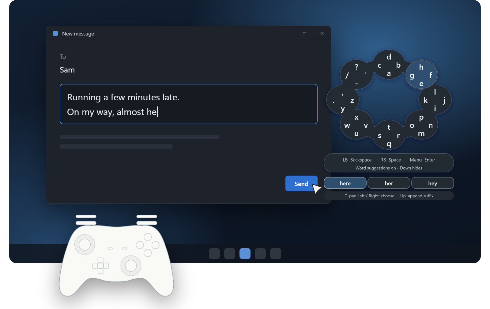
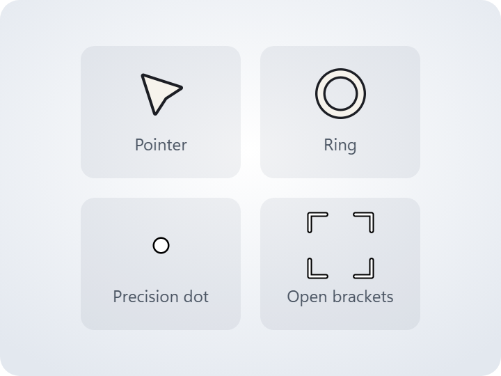
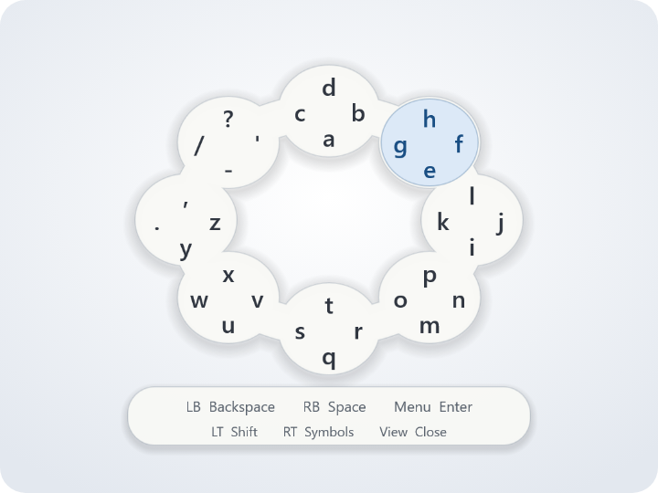
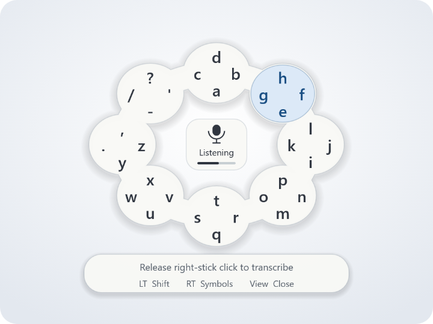

<h1 align="center">Overworld</h1>

<p align="center">
  <b>Natural, automatic controller support for the Windows desktop</b><br>
  Move the pointer, click, scroll, and type with a gamepad, and switch back to your mouse or keyboard at any time.
</p>

<p align="center">
  <a href="https://github.com/Kevin-Taha/overworld/releases">Download</a> ·
  <a href="docs/USAGE.md">Usage guide</a> ·
  <a href="#build-from-source">Build from source</a> ·
  <a href="docs/TROUBLESHOOTING.md">Troubleshooting</a>
</p>

<p align="center">
  
</p>

<p align="center">
  Windows · x64 and ARM64 · early development
</p>

## How it works

Overworld runs in the background and responds to whichever device you're using,
with no mode to pick or setting to change.

- **Controller:** moving a stick moves the pointer, and A clicks.
- **Typing:** pressing Y in a text field opens a keyboard beside it.
- **Mouse and keyboard:** using either one takes over from the controller right away.
- **Games:** Overworld tries to recognize games automatically and leaves the controller to them.

The [usage guide](docs/USAGE.md) lists every control.

## Features

<table>
  <tr>
    <td width="33%" valign="top">
      <picture>
        <source media="(prefers-color-scheme: dark)" srcset="docs/images/pointer-dark.png">
        
      </picture>
      <h3>Pointer</h3>
      Move, click, drag, and scroll anywhere on the desktop. The cursor appears
      as soon as you use the controller. Choose its style and speed in Settings.
    </td>
    <td width="33%" valign="top">
      <picture>
        <source media="(prefers-color-scheme: dark)" srcset="docs/images/keyboard-dark.png">
        
      </picture>
      <h3>Keyboard</h3>
      Type with the stick and face buttons. The keyboard floats beside the text
      field without taking focus from it, and suggests words as you go. A
      one-handed mode is available in Settings.
    </td>
    <td width="33%" valign="top">
      <picture>
        <source media="(prefers-color-scheme: dark)" srcset="docs/images/voice-dark.png">
        
      </picture>
      <h3>Voice typing (optional)</h3>
      In voice-enabled builds, turn on voice input in Settings. Press and hold
      the right stick, speak, and release. Speech is recognized on your PC and
      nothing is uploaded.
    </td>
  </tr>
</table>

## Get started

1. Download the build for your PC (x64 or ARM64) from
   [Releases](https://github.com/Kevin-Taha/overworld/releases) when one is
   available. Release files are individual, not a ZIP. Keep the `controllers`
   and `licenses` folders, and `models` for voice builds, next to
   `Overworld.exe`.
2. Close any running copy of Overworld or Gamepad Desktop, then start
   `Overworld.exe`.
3. Let go of the controller, then move a stick to begin.

Xbox-compatible (XInput) controllers work directly. Many DirectInput/HID
controllers work through the included community mapping database; others need
a [custom mapping](docs/CONTROLLERS.md).

## Good to know

- **Lightweight:** no driver, service, startup entry, or external remapper.
- **Pausing:** **Ctrl+Alt+F10** or **Pause** in the tray menu stops controller
  input, and View + Menu switches between desktop control and game input.
- **Game detection:** automatic but best-effort. If Overworld guesses wrong, use
  View + Menu or add the app to the exclusions list in Settings.
- **Privacy:** word suggestions use a built-in English word list and never read
  field text. Voice input is opt-in, push-to-talk, and offline. See
  [Privacy](docs/PRIVACY.md).
- **Sensitive fields:** some apps change fields without Windows noticing, and
  browser or custom password fields can't always be detected. Turn off word
  suggestions for sensitive use.

Overworld does not steal focus, replace clipboard contents, or replay input it
isn't sure was delivered. It is not a replacement shell or a guaranteed
accessibility tool. See [Troubleshooting](docs/TROUBLESHOOTING.md) for known
limits and recovery.

## Build from source

Requires Windows, Visual Studio 2022 with the C++ desktop workload and a Windows
SDK, CMake 3.24+, Git, and PowerShell. From the repository root:

```powershell
git clone https://github.com/Kevin-Taha/overworld.git
Set-Location .\overworld
cmake -S . -B out\x64 -G "Visual Studio 17 2022" -A x64 -DOVERWORLD_VOICE_WHISPER=OFF
if ($LASTEXITCODE) { throw 'Configure failed.' }
cmake --build out\x64 --config Release --parallel 1 -- /nodeReuse:false
if ($LASTEXITCODE) { throw 'Build failed.' }
ctest --test-dir out\x64 -C Release --output-on-failure
if ($LASTEXITCODE) { throw 'Deterministic tests failed.' }
```

This produces `out\x64\Release\Overworld.exe` without voice support. Configure
downloads the hash-pinned controller mapping database. Default tests don't read
controllers, open the microphone, or inject input. See
[Building](docs/BUILDING.md) for ARM64, voice builds, offline inputs, and
packaging.

## Documentation

| Guide | Contents |
| --- | --- |
| [Usage](docs/USAGE.md) | All controls, typing modes, voice setup, and Settings |
| [Controllers](docs/CONTROLLERS.md) | Supported controllers and custom mappings |
| [Troubleshooting](docs/TROUBLESHOOTING.md) | Recovery steps and known OS/app limits |
| [Privacy](docs/PRIVACY.md) | What is and isn't recorded; read before sharing diagnostics |
| [Building](docs/BUILDING.md) and [Testing](docs/TESTING.md) | Build flavors, ARM64, and test suites |
| [Architecture](docs/ARCHITECTURE.md) | How the pieces fit together |

## Contributing

Read [Contributing](CONTRIBUTING.md), [Architecture](docs/ARCHITECTURE.md),
[Testing](docs/TESTING.md), and the [agent instructions](AGENTS.md) before
changing behavior. The [roadmap](docs/PLAN.md) records scope and retired
experiments. The [Practice harness](docs/PRACTICE-HARNESS.md) is a separately
built development tool, not part of the app.

Use [Issues](https://github.com/Kevin-Taha/overworld/issues) for redacted bug
reports and focused proposals. Report vulnerabilities through
[Security](SECURITY.md), not public issues. Maintainers should review
[Publication readiness](docs/PUBLISHING.md) before changing visibility or
distributing a release.

## License and third-party material

Overworld's original code and documentation are licensed under the [MIT License](LICENSE).
Separately identified third-party material retains its own terms:

| Material | License and attribution |
| --- | --- |
| Embedded word-frequency vocabulary, including its filtered selection/order | [CC BY-SA 4.0](third_party/prediction-CC-BY-SA-4.0.txt), with [source, modifications, and attribution](third_party/prediction-notices.txt) |
| SDL-format controller mapping database | zlib license, fetched and hash-verified with the pinned database; [details](docs/CONTROLLERS.md) |
| Optional whisper.cpp/ggml and Whisper tiny.en weights | MIT; [voice notices](third_party/voice-notices.txt) and the fetched dependency license |

Include `LICENSE` and the required third-party notices/licenses with
distributions, including voice-off builds. MIT does not replace the vocabulary's
attribution/ShareAlike requirements. The vocabulary comes from subtitles and can
contain names, slang, and offensive language; it is not child-safe.
